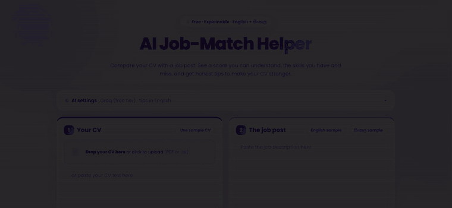
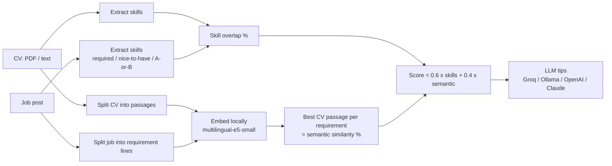

# 🎯 AI Job-Match Helper

Paste or upload your CV and a job post, and get:

- a **match score (0-100) you can actually understand**, not just an LLM's guess
- the **skills you have and the ones you're missing** (required vs nice-to-have)
- **which job requirements your CV covers least**
- **concrete, honest CV tips** from an LLM: rewritten bullets, how to close each gap, keywords to add

Works with **English and Sinhala (සිංහල)** job posts and CVs, and can write the tips in either language.


<!-- TODO: record a short GIF (sample CV -> Check match -> Get CV tips), save it as assets/demo.gif -->


## Features

- **Explainable score** = 60% skill overlap + 40% semantic similarity (weights are configurable)
- **Skill extraction** from a dictionary of ~70 tech and soft skills with aliases (`sklearn` → scikit-learn, `k8s` → Kubernetes), careful word boundaries (`Java` is not found inside `JavaScript`, `C++` still matches), and Sinhala aliases (සන්නිවේදන → Communication)
- **Understands job post structure**: skills under "Nice to have:" or lines saying "is a plus" count half, and "FastAPI or Flask" counts as one skill you can satisfy either way
- **Requirement coverage**: each job requirement is compared with every part of your CV using a local multilingual embedding model, so you see exactly which requirement is weakest and the closest line in your CV
- **The score is free and private**: it is computed on your laptop. Only the optional "CV tips" step calls an LLM
- **Swap the LLM from the sidebar**: Groq (free tier, default), Ollama (local), OpenAI or Anthropic Claude
- **Honest tips**: the prompt forbids inventing experience and asks for rewritten bullets using only facts from your CV
- Tested with **pytest** (offline, under a second) and linted with **ruff** in GitHub Actions

## How the score works



1. **Skill overlap**: the job's skills are found and split into *required* and *nice-to-have*. Score = required skills found + half of nice-to-haves found, divided by the total possible.
2. **Semantic similarity**: every requirement line ("Hands-on experience with LLMs and RAG") is embedded and compared with every passage of your CV. The best match per requirement is rescaled to 0-100%, then averaged. This catches experience described in different words ("built a chatbot over PDFs" vs "RAG").
3. **Final score**: a weighted mix of the two. Both parts, and the exact skills and lines behind them, are shown in the app.
4. **Tips**: the LLM gets the CV, the job post and this analysis, so its advice is grounded in real numbers instead of guessing.

## Project structure

```
├── app.py               # Streamlit UI
├── jobmatch/
│   ├── loader.py        # PDF / text -> clean text
│   ├── skills.py        # skill dictionary + extraction (required / optional / A-or-B)
│   ├── embeddings.py    # local sentence-transformers wrapper
│   ├── scorer.py        # the explainable match score
│   ├── advisor.py       # prompt + streamed CV tips (English / Sinhala)
│   ├── llm.py           # one streaming interface over 4 providers
│   └── config.py        # settings from .env
├── samples/             # sample CV + English and Sinhala job posts
└── tests/               # offline tests with a fake embedder and LLM
```

## Getting started (Windows)

Requires Python 3.10+. In **cmd**:

```bat
cd "D:\Personal_Projects\AI job-match helper"
python -m venv .venv
.venv\Scripts\activate
pip install -r requirements.txt
copy .env.example .env
```

Open `.env` in Notepad and paste your free Groq key after `GROQ_API_KEY=` (get one at [console.groq.com/keys](https://console.groq.com/keys)). Then:

```bat
streamlit run app.py
```

Open http://localhost:8501 and click **Load sample** in the sidebar to try it.

The first "Check match" downloads the embedding model (about 470 MB), so it takes a few minutes once. After that it's fast.

> macOS / Linux: use `source .venv/bin/activate` and `cp .env.example .env`.

### Other LLMs

- **Ollama (local, free)**: install from [ollama.com](https://ollama.com/download), run `ollama pull llama3.2`, pick Ollama in the sidebar. Small local models are weak at Sinhala.
- **OpenAI / Claude (paid)**: set `OPENAI_API_KEY` or `ANTHROPIC_API_KEY` in `.env`, or paste the key in the sidebar.
- Groq retires models from time to time. If you get a "model not found" error, pick a current model in the [Groq playground](https://console.groq.com/playground) and set `GROQ_MODEL` in `.env` (or type it in the sidebar).

## Configuration

| Variable | Default | What it does |
|---|---|---|
| `LLM_PROVIDER` | `groq` | Provider selected when the app opens |
| `GROQ_MODEL` | `openai/gpt-oss-120b` | Model for each provider (`OLLAMA_MODEL`, `OPENAI_MODEL`, `ANTHROPIC_MODEL` too) |
| `EMBEDDING_MODEL` | `intfloat/multilingual-e5-small` | Any sentence-transformers model. `multilingual-e5-base` is better but 1.1 GB |
| `SKILL_WEIGHT` / `SEMANTIC_WEIGHT` | `0.6` / `0.4` | How much each part counts in the final score |

To teach the app new skills, add them to `SKILLS` in [`jobmatch/skills.py`](jobmatch/skills.py).

## Running tests

```bat
pip install -r requirements-dev.txt
pytest
ruff check .
```

## Privacy

The score runs fully on your computer. When you click **Get CV tips**, your CV and the job post are sent to the LLM provider you picked (or stay local with Ollama). Use the sample CV for demos if you'd rather not send your own.

## Limitations and ideas for next steps

- Skill extraction is dictionary-based: precise and explainable, but it only knows skills in the list. An LLM-based extractor could be added as a fallback.
- The semantic part is calibrated for E5 models; other embedding models may need a different range in `calibration_for()`.
- Scanned PDF CVs have no text layer. OCR (e.g. Tesseract with the `sin` model) would fix that.
- Ideas: compare one CV against several jobs and rank them, export the tips as a PDF, deploy to Streamlit Community Cloud.

## License

[MIT](LICENSE)
